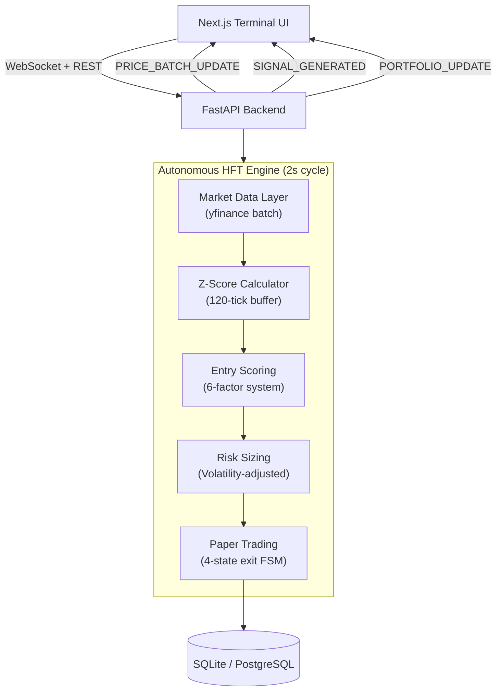

# Algorithmic Trading Simulator: Quantitative Terminal & Execution Engine

[](https://opensource.org/licenses/MIT)
[](https://python.org)
[](https://nextjs.org)
[](https://fastapi.tiangolo.com)

A real-time algorithmic trading simulation engine with a WebSocket-driven terminal UI. AlphaTrigger executes a **V8 Risk-First** quantitative strategy: a statistically-driven Z-Score mean reversion model with dynamic volatility-adjusted position sizing, trailing stop management, and a multi-factor entry scoring engine operating on a 2-second simulation cycle.

> **Disclaimer:** This project is built strictly for educational and portfolio demonstration purposes. It does not execute real trades, connect to real brokerage accounts, or provide financial advice.

---

## Table of Contents
- [Problem Statement](#problem-statement)
- [Key Features](#key-features)
- [Tech Stack](#tech-stack)
- [Architecture and Diagrams](#architecture-and-diagrams)
- [Core Engines Deep Dive](#core-engines-deep-dive)
- [API Overview](#api-overview)
- [Local Setup Instructions](#local-setup-instructions)
- [What I Learned](#what-i-learned)
- [Future Roadmap](#future-roadmap)

---

## Problem Statement

Most retail "algo trading" tools are either opaque black boxes or simplistic indicators that ignore execution costs, slippage, and risk management. Professional quantitative trading systems operate on principles that are rarely exposed to the educational community: statistical edge detection, volatility-normalized position sizing, and state-machine-based trade lifecycle management.

**AlphaTrigger AI** demystifies this by building a fully transparent, autonomous HFT simulation engine where every decision — from entry scoring to trailing stop activation — is deterministic, auditable, and operates against live market data in real-time.

---


## Business Value & Target Audience

- **Target Audience:** Quantitative (quant) traders and crypto enthusiasts who suffer from emotion-driven trading errors in highly volatile markets.
- **Value Proposition:** An emotionless, fully automated trading bot utilizing Z-Score mean reversion algorithms and volatility-adjusted position sizing, ensuring strict adherence to risk management parameters.

## Monetization Strategy

- **Freemium:** Free access to historical backtesting and paper trading simulation.
- **Premium ($29.99/mo):** Direct API integration with real exchanges (Binance, Alpaca) for live trade execution, plus sub-second WebSocket market data access.

## Key Features

- **V8 Risk-First Autonomous Engine:** A fully autonomous trading orchestrator running on a 2-second HFT cycle. It scans a curated 5-coin crypto universe, scores entry opportunities on a 6-factor system, and executes paper trades with zero human intervention.
- **Z-Score Mean Reversion:** Entries are triggered by statistical deviation from a 120-tick rolling mean, ensuring trades are taken only at high-probability reversion points.
- **Dynamic Volatility-Adjusted Sizing:** Stop-loss and take-profit levels are calculated from real-time price volatility (rate-of-change standard deviation), not fixed percentages.
- **4-State Exit Machine:** A deterministic state machine manages trade exits through Hard Stop, No-Follow-Through, Break-Even Stop, Trailing Stop, Take Profit, and Time Stop.
- **Real-Time WebSocket Terminal:** A premium dark-mode dashboard with live price streaming, active position tracking, execution tape, and performance analytics — all driven by sub-second WebSocket broadcasts.
- **Realistic Execution Simulation:** Every paper trade includes randomized slippage, entry/exit commission fees, and leveraged PnL calculations.
- **Dynamic Watchlist Management:** Add/remove assets with live price, change%, Relative Strength, and signal data streamed via WebSocket.

---

## Tech Stack

### Frontend
- **Framework:** Next.js 14 (App Router), React 18
- **Styling:** Custom CSS Design System (Dark Terminal Aesthetic)
- **Real-Time:** Native WebSocket client with auto-reconnect and exponential backoff
- **Icons:** Lucide-React

### Backend
- **Framework:** FastAPI (Python 3.11+)
- **Database:** SQLite (development) / PostgreSQL (production-ready via Docker)
- **ORM:** SQLAlchemy 2.0, Pydantic v2
- **Market Data:** yfinance (batch async fetching)
- **Orchestration:** `asyncio` background task with 2-second HFT cycle

### DevOps and Infrastructure
- **Containerization:** Docker and Docker Compose
- **Data Pipeline:** In-memory ring buffers (120-tick) for statistical computation

---

## Architecture and Diagrams



---

## Core Engines Deep Dive

### 1. V8 Entry Scoring System (6-Factor)

Every potential entry is scored on a 0–6 scale. A minimum of **4 points** is required to trigger a trade:

| Factor | Condition | Points |
| :--- | :--- | :---: |
| **Z-Score Strength** | Price > 1.5σ from 120-tick mean | +1 |
| **Extreme Z-Score** | Price > 2.5σ from mean | +1 |
| **Momentum Confirmation** | Last 2 ticks show upward direction | +1 |
| **Volatility/Range** | Market not flat (> 0.03% range) | +1 |
| **BTC Leader Confirmation** | BTC rate-of-change ≥ -0.01% | +1 |
| **Volume Spike** | Volume delta > 10,000 units vs previous tick | +1 |
| **Loss Penalty** | Recent losses on this ticker | -1 to -3 |

### 2. 4-State Exit Machine

```
OPEN → [Hard Stop Hit?] → CLOSED_LOSS
     → [No movement in 45s + MFE < 0.1%?] → CLOSED (NO_FOLLOW_THROUGH)  
     → [MFE ≥ 0.5R but PnL ≤ 0?] → CLOSED (Break-Even Stop)
     → [MFE ≥ 0.8R, drawdown > 0.4R?] → CLOSED (Trailing Stop)
     → [Price hits TP?] → CLOSED_WIN (Target Hit)
     → [Age ≥ 300s?] → CLOSED_TIMEOUT (Time Stop)
```

### 3. Risk-Normalized Position Sizing

```
Dynamic SL% = max(0.8%, Volatility × 3.0)
Dynamic TP% = SL% × 2.0   (1:2 Risk/Reward)
Risk USD    = Portfolio × 0.25%
Notional    = Risk USD / SL%
```

---

## API Overview

The REST API is documented via Swagger UI at `/docs`.

| Method | Endpoint | Description |
| :--- | :--- | :--- |
| `GET` | `/api/v1/watchlist/` | Retrieve all watchlist items |
| `POST` | `/api/v1/watchlist/` | Add a ticker to the watchlist |
| `DELETE` | `/api/v1/watchlist/{id}` | Remove a ticker from watchlist |
| `GET` | `/api/v1/paper-trades/` | List paper trades (last 100) |
| `GET` | `/api/v1/paper-trades/summary` | Aggregate performance metrics |
| `GET` | `/api/v1/user/portfolio` | Current portfolio value and liquidity |
| `GET` | `/api/v1/signals/` | List generated signals |
| `GET` | `/api/v1/settings/` | Current engine configuration |
| `WS` | `/api/v1/ws/` | Real-time WebSocket stream |

### WebSocket Event Types
- `PRICE_BATCH_UPDATE` — Live price/volume/change/RS for all watchlist tickers
- `SIGNAL_GENERATED` — New trade signal with entry, SL, TP, and score breakdown
- `PORTFOLIO_UPDATE` — Net liquidity, unrealized PnL, active position count

---

## Local Setup Instructions

### Prerequisites
- Python 3.11+
- Node.js 18+

### 1. Backend Setup
```bash
cd backend
python -m venv venv
source venv/bin/activate  # Windows: venv\Scripts\activate
pip install -r requirements.txt
uvicorn app.main:app --host 0.0.0.0 --port 8000
```

### 2. Frontend Setup
```bash
cd frontend
npm install
npm run dev
```

The terminal will be live at [http://localhost:3000](http://localhost:3000) and the API at [http://localhost:8000/docs](http://localhost:8000/docs).

### 3. Docker (Optional)
```bash
docker-compose up --build
```

---


### Environment Variables Configuration

| Variable | Required | Description |
|----------|----------|-------------|
| `BINANCE_API_KEY` | Optional | Required for live exchange execution |
| `BINANCE_SECRET` | Optional | Encrypted secret for trade signing |
| `DATABASE_URL` | ✅ | SQLite or PostgreSQL connection string |
| `NEXT_PUBLIC_WS_URL` | ✅ | Backend WebSocket endpoint for Next.js |

## What I Learned

- **Real-Time Systems Architecture:** Designing a WebSocket-driven data pipeline that broadcasts market updates at sub-second intervals while maintaining state consistency across multiple connected clients.
- **Statistical Trading Systems:** Implementing Z-Score mean reversion with rolling buffers, understanding why naive technical indicators fail without volatility normalization.
- **State Machine Design:** Building a deterministic 4-state exit manager that handles edge cases (zero-value updates, stale connections, race conditions) without data loss.
- **Risk Engineering:** Learning why fixed-percentage stop-losses fail in volatile markets and implementing volatility-adjusted position sizing that scales risk dynamically.
- **Full-Stack Integration:** Coordinating a FastAPI async backend with a Next.js frontend through both REST and WebSocket channels, handling CORS, trailing-slash routing, and hydration mismatches.

---

## Future Roadmap

- [ ] **Multi-Exchange Connectors:** Integrate Binance/Coinbase WebSocket feeds for true sub-second price data.
- [ ] **Backtesting Engine:** Run the V8 strategy against multi-year historical data with walk-forward optimization.
- [ ] **Strategy Builder UI:** Allow users to define custom entry/exit rules and scoring weights via the terminal.
- [ ] **Sentinel Alerts:** Push trade signals to Telegram/Discord/Slack via webhooks.
- [ ] **Advanced Charting:** Integrate TradingView Lightweight Charts for interactive candlestick visualization.
- [ ] **ML Signal Enhancement:** Layer a gradient-boosted model on top of the deterministic scoring system.

---

## Legal Disclaimer

AlphaTrigger AI is a **simulation-only** research and educational tool. It does not execute real trades, does not connect to real brokerage accounts, and does not constitute financial or investment advice. Market data may be delayed. Trading involves significant risk of loss.

---

© 2026 AlphaTrigger AI. Engineered by Yigit Sarp Avci.
